<picture>
  <source media="(prefers-color-scheme: dark)" srcset="./assets/singularity-hero-dark.svg">
  
</picture>

<picture>
  <source media="(prefers-color-scheme: dark)" srcset="./assets/singularity-telemetry-dark.svg">
  
</picture>

Reading the instruments

- **Accretion disk:** one particle per day of the last year; brighter and closer to the hole means a busier day. Inner rings orbit faster, as they would around a real black hole.
- **Orbit:** contributions per month, plotted as a closed trajectory; the beacon marks the busiest month.
- **Spectral composition:** language share by bytes across public repositories.
- **Light theme:** rendered as a photographic negative, the way astronomical survey plates were printed.

Artwork: original animated SVG, generated by README Templates · template: Singularity. Motion stops if your system asks for reduced motion.

#### Flight log

- `MSN-01` **[PORTFOLIO-V3](https://github.com/Aryansahu69-py/PORTFOLIO-V3)** · My portfolio website with New UI/UX design . In this i am going to use NeoBrutalism   
  HTML · ★ 2
- `MSN-02` **[SwiggyClone](https://github.com/Aryansahu69-py/SwiggyClone)** · This is the clone website i am building using only tailwind CSS   
  HTML · ★ 2
- `MSN-03` **[DebugBATTLE](https://github.com/Aryansahu69-py/DebugBATTLE)** · this is the event for debugging the website organized by NYC . In this by bhavya (Mentor) a repo is given and the website is very giltchi so we have to fix all the things  
  CSS · ★ 2
- `MSN-04` **[TAYCAN](https://github.com/Aryansahu69-py/TAYCAN)** · This is Car Featured Webpage  
  CSS · ★ 2
   
<h3><b>TECHNICAL PAYLOAD</b></h3>
<h4>Frontend</h4>

<h4>Programming languages</h4>

<h4>Tools</h4>

<h4>Future missions</h4>

 

 

  

<picture>
  <source media="(prefers-color-scheme: dark)" srcset="./assets/singularity-end-dark.svg">
  
</picture>

